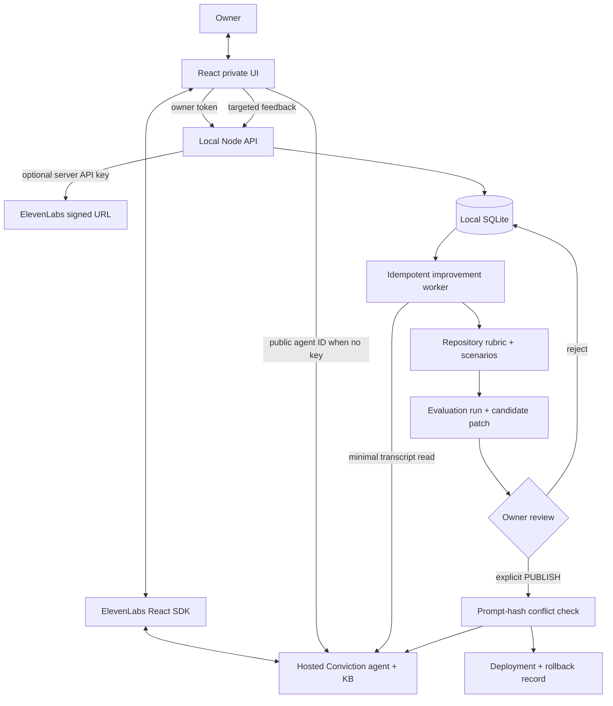

# Architecture

## Safety properties

1. Feedback persistence and live conversational repair are independent. A failed correction message does not erase the durable feedback event.
2. `idempotency_key` is unique, and one database job is created per accepted feedback record.
3. The evidence selector stores only nearby turns and records whether the target was exact or approximate. In no-key mode, the authorized excerpt is supplied by the browser rather than fetched from ElevenLabs.
4. Missing semantic evaluation produces `UNKNOWN` results and no publishable patch.
5. A proposal records the active prompt hash. Publication fails if the live prompt changed in the meantime.
6. Rollback succeeds only if the live prompt still matches the deployment being rolled back.
7. Publishing is a separate owner action; the worker has no automatic publication path.
8. A non-loopback server bind requires an owner token; a missing token fails startup.
9. Local feedback is purged on startup according to `LOCAL_RETENTION_DAYS` and can be deleted by the owner.

## Storage

SQLite tables:

- `feedback`: immutable user intent plus processing status
- `jobs`: retryable, idempotent worker state
- `evaluation_runs`: rubric version, minimal evidence, and result
- `proposals`: candidate patch, base hash, test report, and owner decision
- `deployments`: before/after prompts and provider result for rollback
- `audit_log`: append-only state-change record
