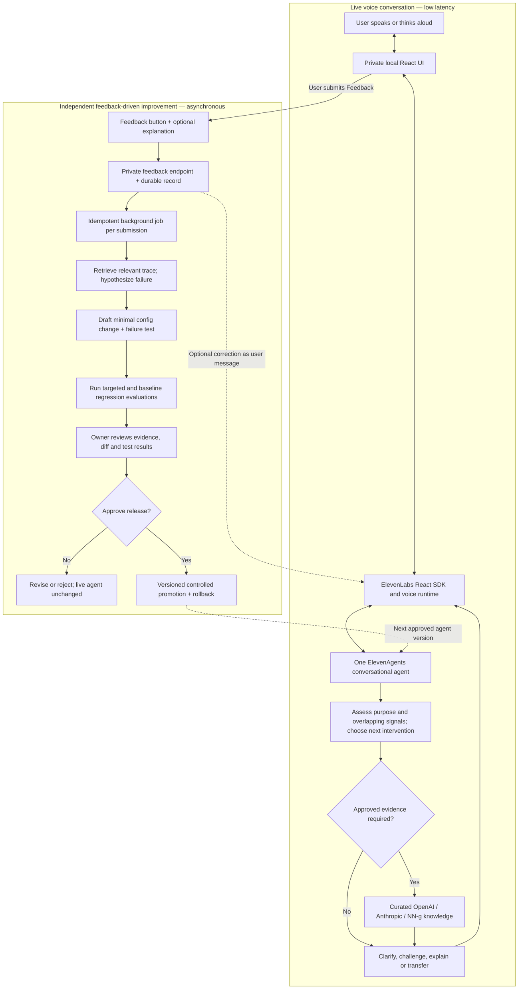

# Conviction — README architecture (v1.3)

> *Think it through. Make it your own.* Conviction is a private voice-first thinking partner for AI-agent engineering and mental-model exploration. It tries to identify **the highest-value next intervention**—clarify, challenge, explain, retrieve evidence, or transfer—while keeping the user's reasoning their own.

## Architecture

## Responsibilities

| Layer | Owner | Purpose |
|---|---|---|
| Speech transport, turn detection, speech processing and generation | ElevenLabs | Handle low-latency audio interaction |
| Conversational decision policy | Versioned system prompt + model | Infer purpose and overlapping understanding signals; choose next step |
| Evidence | Approved ElevenLabs KB | Selective grounding; avoid unnecessary calls |
| Local experience | React + `@elevenlabs/react` | Custom interface, voice controls and Feedback button |
| Session authorization | Small local/private server | Issue short-lived credentials for a **private** agent; never expose API key |
| Feedback persistence and trigger | Local/private backend | Record feedback with real session/response reference, queue job exactly once |
| Evaluation runner | Local/private worker and/or supported ElevenLabs tests | Build a failure case, draft changes, compare with regression suite |
| Release authority | Human owner | Review candidate, approve versioned deployment, retain rollback |

**Not a hard-coded classifier:** Ambiguity, weak assumptions, missing knowledge, current understanding, and readiness can overlap. The agent chooses one primary move and at most one compatible secondary move. Clarify/challenge/transfer are conversational behaviors, **not** external tool calls.

## Curated knowledge (no live search initially)

Start by verifying these three: [OpenAI Practical Guide to Building AI Agents](https://openai.com/business/guides-and-resources/a-practical-guide-to-building-ai-agents/), [Anthropic Effective Context Engineering](https://www.anthropic.com/research/effective-context-engineering-for-ai-agents), and [Nielsen Norman Group Mental Models](https://www.nngroup.com/articles/mental-models/). Expand selectively with Anthropic's [Building Effective Agents](https://www.anthropic.com/research/building-effective-agents), OpenAI's [Agent Improvement Loop](https://developers.openai.com/cookbook/examples/agents_sdk/agent_improvement_loop), and evaluation guidance. Import is **not** assumed to have succeeded; log status and rights in a source manifest.

No active work-project corpus or proprietary company information. Live web search is **not implemented** in this version; a later narrow tool can cover unfamiliar architectures and newly published evaluation research if justified.

## Feedback button: one event, two independent paths

**User interaction:** Click **Feedback** next to/after an agent response. Optionally describe what went wrong and what should have happened. Submit.

**Path A — Immediate conversation:** When a note is entered during an active session, send it as a regular user message (`sendUserMessage`) **by default** so the agent can repair the answer, with a **Record only** option. Do not send a fabricated turn if the note is empty or the session ended. The submission is recorded either way.

**Path B — Independent improvement job:** A private feedback API persists `feedback_id`, `conversation_id`, the real response ID if available (otherwise a timestamp/approximate reference), user's original note, optional expected behavior, and status. After durable acknowledgment, enqueue one idempotent background job. It fetches minimal evidence, diagnoses probable failure, proposes a small patch and test, compares targeted and baseline evaluations, and stops for owner approval. No workflow operation holds up the voice response.

An optional SDK `sendFeedback(false)` signal is **not** a replacement for this structured event; it does not by itself contain a user explanation or power the job pipeline. Do not falsely claim the platform natively auto-rewrites the agent after pressing a button.

## Safe improvement loop

1. **Observe:** Retain minimally necessary consented evidence, identify the actual target turn; report ambiguity instead of inventing references.
2. **Diagnose:** Distinguish factual errors, wrong next move, verbosity, retrieval, depth, and speech/transcript failures. A complaint is not automatically ground truth.
3. **Propose:** Minimal prompt/KB/tool or voice-setting diff on a staged candidate, plus a test representing the failure.
4. **Compare:** Targeted test and existing regression scenarios; note costs, latency, and unsupported claims.
5. **Approve:** Owner reviews and explicitly approves or rejects. Only an approved change reaches the running agent; keep prior version available for rollback.

Every feedback submission triggers **an analysis/test attempt**, not an automatic production edit. Queue, deduplicate, and rate-limit jobs to control costs. If the runner is unavailable or tests are unsupported under the account plan, surface `failed` or `needs-owner-review` rather than reporting success.

## Operational and privacy boundaries

- This is a **local/private** project. A public GitHub repository contains sanitized source code, prompts, schema, scenario tests and simulated/redacted evaluation notes—not actual private user sessions, API keys, or a callable unrestricted voice endpoint.
- The browser uses session credentials issued by a small server for the private ElevenLabs agent; no private API key in React or `VITE_` variables.
- Do not persist entire transcripts by default. Only minimal snippets and references needed for the flagged issue; respect ElevenLabs retention and deletion controls.
- Creating a dashboard agent and attaching KBs is separate from implementing the private React feedback UI and improvement runner. ElevenLabs' **paid** Architect capabilities can help with changes/testing, but are not an assumed free or automatically triggered dependency.
- Voice minutes, model usage, agent testing, and improvement tasks may incur plan-dependent costs; validate before activating automated tests.

## Implementation milestones and evidence

| Milestone | Status at PRD drafting | Evidence required |
|---|---|---|
| M0 Agent + KB + baseline policy | Planned | Actual dashboard conversation and observed test outputs |
| M1 Local private UI + feedback | Planned | Real conversation ID, persisted feedback, no exposed keys |
| M2 Feedback-triggered evaluation runner | Planned | One accepted event -> one completed or honestly failed job |
| M3 Owner review, approval and rollback | Planned | Before/after test report, versioned approved change |
| M4 GitHub demo | Planned | Sanitized repo, README and recorded walkthrough |

**Do not describe M2 or M3 as completed until the end-to-end integration has been verified.**
